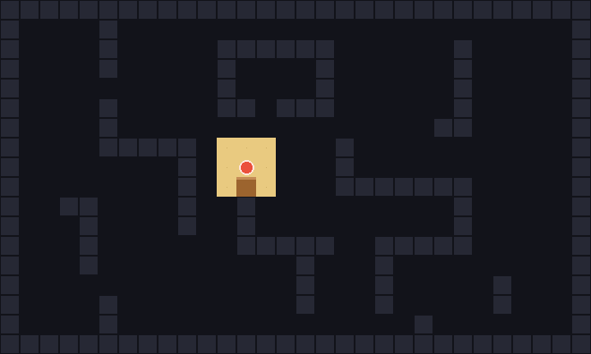
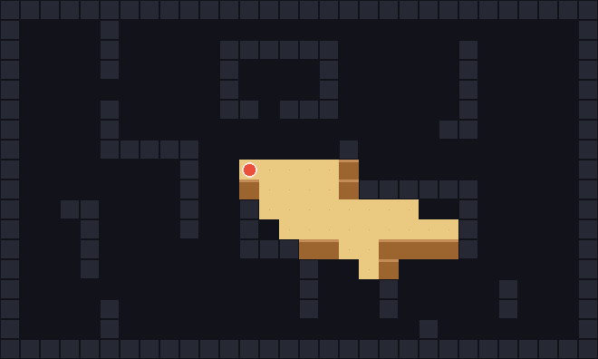
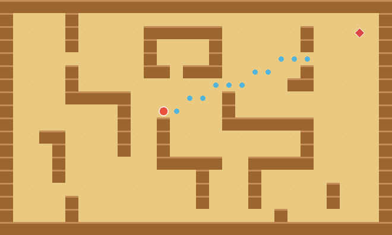
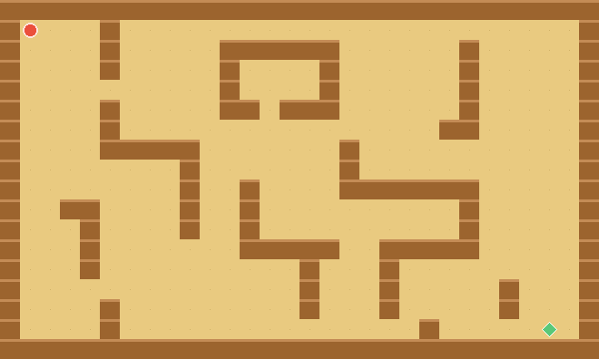
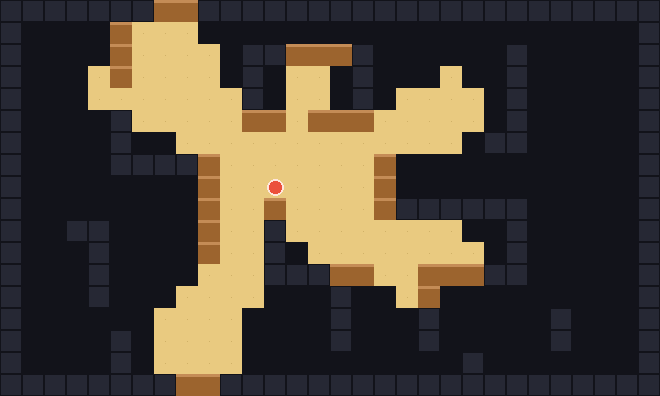
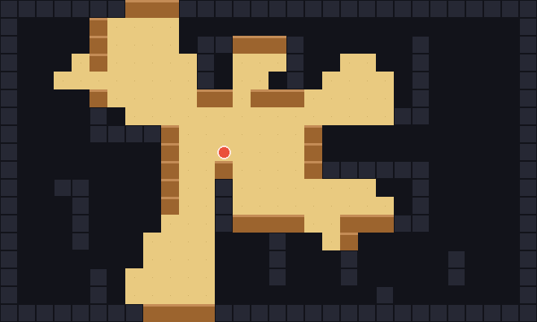

# rlforj-alt

[](https://github.com/fabio-t/rlforj-alt/releases/latest)
[](https://github.com/fabio-t/rlforj-alt/actions/workflows/ci.yml)
[](LICENSE)

Roguelike Library For Java (Alternative version).

The main aim of this library is to provide a set of simple, yet efficient, algorithms for common problems in
the development of roguelikes and other games:

* **FoV**: the field of view is the area around a game entity that is visible. Commonly, things like walls and trees
  block vision. This is provided in both circular and conic format.

* **LoS**: the line of sight is a linear path from a starting position to a target position, provided there are
  no obstacles between them. It's useful for ranged attacks, for example.

* **Pathfinding**: given a map, we want to find the optimal, nonlinear path between a start and end point. This
  may also take account of the terrain, to give preference to paths avoiding slow-moving terrains, for example.

| Field of View | Cone FoV |
| :---: | :---: |
|  |  |

| Line of Sight | Pathfinding (A*) |
| :---: | :---: |
|  |  |

All images in this README are generated by the library itself (see the
[examples](src/main/java/rlforj/examples/)).

## Requirements

* Java 21 or later.

If you use [mise](https://mise.jdx.dev), the repository's `mise.toml` pins a suitable JDK for you:
run `mise install` inside the checkout.

## Install

Releases are published to [GitHub Packages](https://github.com/fabio-t/rlforj-alt/packages).

### Gradle

```kotlin
repositories {
    maven {
        url = uri("https://maven.pkg.github.com/fabio-t/rlforj-alt")
        credentials {
            username = providers.gradleProperty("gpr.user").orElse(System.getenv("GITHUB_ACTOR")).get()
            password = providers.gradleProperty("gpr.key").orElse(System.getenv("GITHUB_TOKEN")).get()
        }
    }
}

dependencies {
    implementation("com.github.fabio-t:rlforj-alt:0.4.0")
}
```

### Maven

Add the repository to your `pom.xml`:

```xml
<repositories>
  <repository>
    <id>github</id>
    <url>https://maven.pkg.github.com/fabio-t/rlforj-alt</url>
  </repository>
</repositories>

<dependency>
    <groupId>com.github.fabio-t</groupId>
    <artifactId>rlforj-alt</artifactId>
    <version>0.4.0</version>
</dependency>
```

Note: GitHub Packages requires authentication even for public packages, so you need a
[personal access token](https://docs.github.com/en/packages/working-with-a-github-packages-registry/working-with-the-apache-maven-registry)
with `read:packages` scope in your `~/.m2/settings.xml` (Maven) or `~/.gradle/gradle.properties` (Gradle).

### Local builds

Alternatively, build and install into your local Maven repository - no tokens needed:

```console
git clone https://github.com/fabio-t/rlforj-alt.git
cd rlforj-alt
./gradlew publishToMavenLocal
```

then depend on `com.github.fabio-t:rlforj-alt:0.4.0` with `mavenLocal()` enabled.

## Use

The main component of rlforj-alt is the so called `Board`. You must implement the [IBoard](src/main/java/rlforj/IBoard.java)
interface before doing anything:

```java
public interface IBoard
{
    boolean contains(int x, int y);

    boolean blocksLight(int x, int y);

    boolean blocksStep(int x, int y);

    void visit(int x, int y);

    // provided default: blocksLight(x, y) || blocksStep(x, y)
    default boolean isObstacle(int x, int y) { /* ... */ }
}
```

* `contains` should check boundaries of your map/level

* `blocksLight` should return true for all positions that block vision (eg, walls). Used by FoV/LoS algorithms

* `blocksStep` should return true for all positions that block movement. Used by pathfinding algorithms

* `visit` will be called by the FoV/LoS algorithms on each visible cell. You may
  use it to store the visible cells or to manipulate the map, or whatever you wish. See below for details on how it's
  used.

### Field of View

To explore all the visible cells (what is generally called `Field of View`) you must choose one of the available
FoV algorithms implementing the [IFovAlgorithm](src/main/java/rlforj/los/IFovAlgorithm.java) interface:

```java
public interface IFovAlgorithm
{
    void visitFoV(IBoard b, int x, int y, int distance);
}
```

Then you can use it like this:

```java
IBoard map = new MyMap();

// choose one of these
IFovAlgorithm a = new ShadowCasting();
IFovAlgorithm a = new PrecisePermissive();

// calls IBoard#visit on all visible cells from the origin and up to the given radius
a.visitFoV(map, originX, originY, radius);
```

The method `IFovAlgorithm#visitFoV` is guaranteed to call `IBoard#visit` **only once** per cell, and always before
`IBoard#blocksLight`. This last thing is important for things like a bomb or fireball: whatever blocking cell the
FoV algorithm encounters, it's destroyed in the `FireballBoard#visit` - and thus the FoV will continue to visit
surrounding cells that were previously shadowed by this cell.

`IBoard#blocksLight` and `IBoard#blocksStep` can be called multiple times at each location.

The two algorithms produce slightly different results - `PrecisePermissive` is, as the name says, more permissive,
while `ShadowCasting` tends to look better in play:

| ShadowCasting | PrecisePermissive |
| :---: | :---: |
|  |  |

### Conic Field of View

In alternative to the above, if you want to only visit a **conic field of view** (eg, for breathing fire, or to
simulate a directional light), you can choose one of the algorithms implementing the
[IConeFovAlgorithm](src/main/java/rlforj/los/IConeFovAlgorithm.java) interface:

```java
public interface IConeFovAlgorithm extends IFovAlgorithm
{
    // Note: positive Y axis is down, so angles grow clockwise
    void visitConeFieldOfView(IBoard b, int x, int y, int distance, int startAngle, int endAngle);
}
```

Then you can use it like this:

```java
IBoard map = new MyMap();

// choose one of these
IConeFovAlgorithm a = new ShadowCasting();
IConeFovAlgorithm a = new ConePrecisePermissive();

// visit all visible cells from the origin and up to the given radius, in a cone of 180 degrees
a.visitConeFieldOfView(map, originX, originY, radius, 0, 180);
```


### Line of Sight

To find a straight, unobstructed line between a start and end point is a task called `Line of Sight`. This is very
useful for ranged attacks.

rlforj-alt supports many LoS algorithms, all implementing the [ILosAlgorithm](src/main/java/rlforj/los/ILosAlgorithm.java)
interface:

```java
public interface ILosAlgorithm
{
    boolean exists(IBoard b, int startX, int startY, int endX, int endY, boolean savePath);

    List<Point> getPath();
}
```

If you only need to **test** for line of sight, set the last argument, `savePath`, to `false`.

More commonly, you will need the path (if one exists), so do this:

```java
IBoard map = new MyMap();

// choose one of these
ILosAlgorithm a = new BresLos(symmetric); // symmetric can be true or false
ILosAlgorithm a = new BresOpportunisticLos();
ILosAlgorithm a = new ShadowCasting();
ILosAlgorithm a = new PrecisePermissive();

List<Point> path;
if (a.exists(map, startX, startY, endX, endY, true))
  path = a.getPath();
else
  // do something else?
```


If you are unsure which LoS algorithm to use, consider this:

- If you need absolute certainty that **if a point is in your Field of View, then it is also in your Line of Sight**,
  then use the same algorithm, `ShadowCasting` or `PrecisePermissive`, for LoS too

- If you need **faster and prettier** Line of Sight, then choose one of the `Bresenham`. We advise you to use
  `BresLos(true)`, eg symmetric Bresenham, unless you have a reason not to

- all algorithms return the same or very similar paths in "good" cases, but may vary wildly in more complicated ones

A final note on paths: if line of sight was established, the path always includes the start and end point. If it
was not, the path contains the partial line up to the first obstacle encountered.

### Pathfinding

Pathfinding is the task of finding an unobstructed path from a start to an end point. Contrarily to LoS,
the path does not need to be a line.

Only one algorithm is supported for now, the king of pathfinding: AStar. Use it like this:

```java
IBoard map = new MyMap();

// true if you allow diagonal movement, false otherwise
boolean diag = true;
AStar a = new AStar(map, map.width(), map.height(), diag);

int radius = -1; // this will search the whole board - it can be very expensive to do so!
radius = 10;     // this will only search the cells in a radius of 10 cells from the starting point
Point[] path = a.findPath(startX, startY, endX, endY, radius);
```

If `path` is not `null`, it always includes the start and end point.


## Examples

Have a look at the [examples folder](src/main/java/rlforj/examples/): each of the FoV, cone FoV and LoS examples
can be run directly and prints its output as ASCII to the terminal, for instance:

```console
./gradlew -q demo
```

## Building from source

```console
./gradlew build
```

This compiles the library, runs the test suite and produces the jars in `build/libs/`.

Disclaimer
---------

This was originally a fork from [kba/rlforj](https://github.com/kba/rlforj) (version 3.0), but has since diverged.
See the LICENSE file for copyright information.
